# VMM PO Governance Platform — User Manual

**For:** buyers, category heads, planners and administrators · **System:** PO Governance portal (current version) ·
**Date:** 27 Oct 2026

The PO Governance Platform checks a purchase order **before it is raised**: it looks at stock, open POs, sales and the
plan for that article and colour, and says whether the quantity is safe, should be reduced, needs the category head's
approval, or should not be raised. Planners use it to review all open POs at once, and SAP can ask it the same question
automatically when a PO is released.

> Screens in this manual were taken on a test system with demo data and demo users (Ravi Kumar — buyer, Priya Sharma —
> category head). Your numbers will differ.

---

## Contents

1. [Getting started (everyone)](#1-getting-started-everyone)
2. [Who can do what](#2-who-can-do-what)
3. [Buyer guide](#3-buyer-guide)
4. [Category head guide](#4-category-head-guide)
5. [Planner guide](#5-planner-guide)
6. [Administrator guide](#6-administrator-guide)
7. [Verdict page (link from SAP)](#7-verdict-page-link-from-sap)
8. [Reference: decisions, terms, messages](#8-reference-decisions-terms-messages)

---

## 1. Getting started (everyone)

### 1.1 Sign in

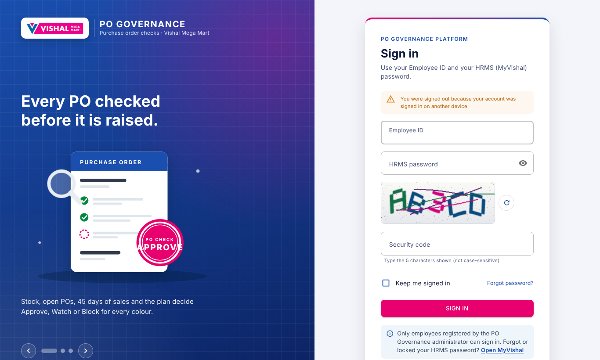

1. Open the portal address your administrator gave you (for example `http://<server>:8177`).
2. Enter your **Employee ID** and your **HRMS password** (the same password as MyVishal).
3. Type the **security code** shown in the picture (5 characters, not case-sensitive; ↻ shows a new picture). A new
   picture appears after every attempt.
4. Tick **Keep me signed in** if the browser should remember you after it is closed, then click **Sign in**.

Good to know:

- **Only employees registered by the administrator can sign in.** A valid HRMS account alone does not give access: if
  you are not registered, the answer is "Employee ID or password is incorrect" — ask the administrator to add you.
- Your **email does not work** as the sign-in ID ("Sign in with your Employee ID and HRMS password.").
- After **5 wrong passwords** your account is locked here for **15 minutes** ("Too many wrong attempts — locked for 15
  minutes."). The administrator can unlock you earlier. HRMS has its own lock: "Your HRMS account is locked…" — unlock
  it in MyVishal (My Page → Unlock User) or wait about 30 minutes.
- **One device at a time.** Signing in on another computer or browser signs out the first one ("You were signed out
  because your account was signed in on another device."); the new one shows "You were signed in on another device —
  that session has been signed out."
- **Idle time-out.** After **30 minutes** without using the portal you are signed out; a minute before, a box asks
  **Stay signed in** or **Sign out**. Working in another tab of the portal counts as activity. After **12 hours** you are
  signed out even when active.
- **When the administrator changes you.** If your roles are changed, your account is deactivated or your Employee ID is
  linked, you are signed out within a minute and asked to sign in again (the sign-in page says why).
- **Forgot your password?** Use **Forgot or locked? Open MyVishal ↗** on the sign-in page — the portal keeps no
  password for you, so the administrator cannot reset it here.

### 1.2 Change your password

Your password is your **HRMS password**: change it in MyVishal. User menu → **🔑 Change password** is not shown for
employees (the page only points to MyVishal).

*Only for the built-in administrator account (email sign-in, see 6.1) and for servers in "Local" sign-in mode:* the
page **Set your own password** / **Change your password** asks for the current password (1234 the first time) and a
new one — at least **8 characters**, with **at least one letter and one number**, not the default password and not
your email.

### 1.3 The screen

| Part | What it does |
|---|---|
| **Top bar tabs** | The pages you may use (see section 2). The ✅ Approvals tab shows a red count of requests waiting for you. |
| **View badge** | "Category View" or "Planner View" next to the logo. Planners and admins can switch (user menu → **⇄ Switch to Category view / Planner view**); everyone else always has the Category view. |
| **Status pill** "● Shared · 2026-10-27" | Shows the server date and that you are connected. "Server unreachable" = the server is not answering; wait or tell IT. |
| **User menu** "Name (role) ▾" | 💬 Feedback, ⏻ Sign out — plus admin pages for administrators (🔑 Change password only for the built-in admin account). |
| **"New data on the server." banner** | A planner uploaded new files or changed parameters. Click **Load now** to work with the new data. |
| **VMM Assistant** (round button, bottom right) | Ask questions about the results you see, e.g. "why was X blocked?". It only answers from data in your session and never changes a decision. Only shown if AI is switched on for your server. |

### 1.4 Feedback

User menu → **💬 Feedback**. Choose **Type** (Problem / Suggestion / Question / Data looks wrong) and **Screen**, add the
article (GM) and colour if it is about a result, write what happened, optionally rate the tool 1–5, and click **Send
feedback**. Your earlier feedback and the administrator's reply are listed below the form.

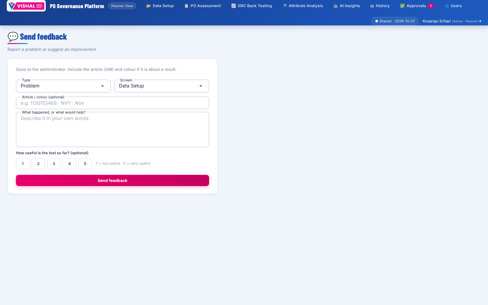

### 1.5 Help inside the portal

- **❓ How it works** — the complete logic of every rule, with the current parameter values.
- **🎬 How-to Video** — short videos per topic (if installed on your server).

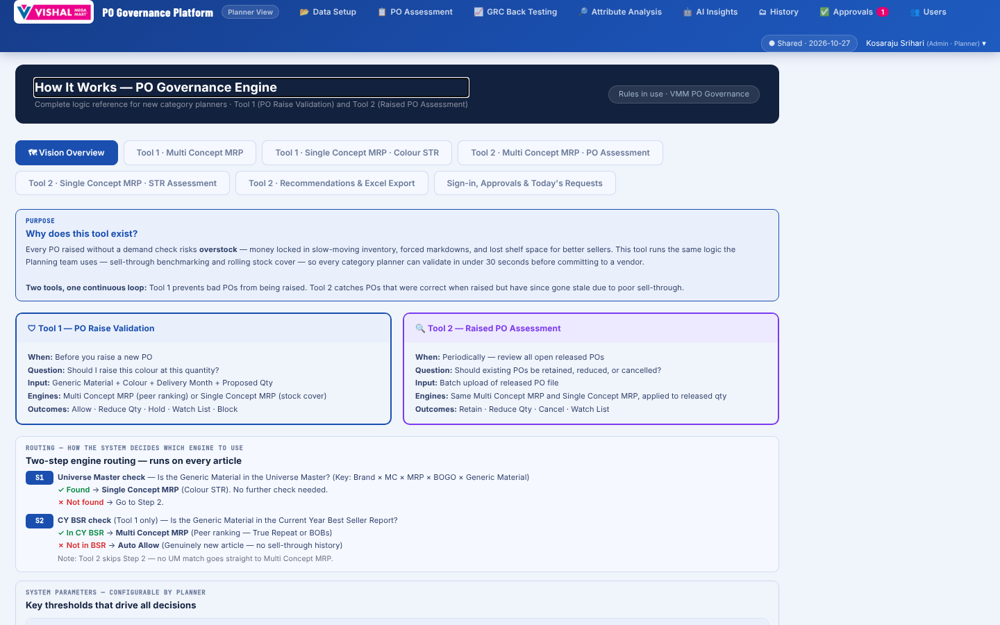

---

## 2. Who can do what

### 2.1 Roles

| Role | Typical user | Main tasks |
|---|---|---|
| **Buyer** | buying team | Check a PO before raising it (New Request); see own requests and results |
| **Category Head** | category heads (Level 3 in the SCR file) | Everything a buyer does, plus **approve or reject Watch List requests** on their own MCs |
| **Planner** | planning team | Load the data files, set parameters, review all open POs (PO Assessment), analytics, approve any Watch List request, clear the day's requests |
| **Admin** | tool administrator | Everything a planner does, plus users and passwords, audit log, backups, feedback replies, SAP interface |

A person can have several roles (shown as e.g. "Admin · Planner"). **Buyers and category heads only see and raise
requests for the Brand × MC × MRP mapped to them in the SCR products file**; for anything else the portal says "This
Brand / MC / MRP is not mapped to you in the SCR products file. Ask the administrator."

### 2.2 Pages by role

| Page | Buyer | Category Head | Planner | Admin |
|---|:-:|:-:|:-:|:-:|
| ✏️ New Request | ✓ | ✓ | ✓ (Category view) | ✓ (Category view) |
| 📄 Requests | ✓ | ✓ | ✓ | ✓ |
| 📊 Insights | ✓ | ✓ | ✓ | ✓ |
| ✅ Approvals | – | ✓ | ✓ | ✓ |
| 🗂 History | ✓ (requests only) | ✓ (requests only) | ✓ | ✓ |
| ❓ How it works · 🎬 How-to Video · 💬 Feedback | ✓ | ✓ | ✓ | ✓ |
| 📂 Data Setup | – | – | ✓ | ✓ |
| 📋 PO Assessment | – | – | ✓ | ✓ |
| 📈 GRC Back Testing · 🔎 Attribute Analysis · 🤖 AI Insights | – | – | ✓ | ✓ |
| 👥 Users · Audit log · Backups · All feedback · 🔌 SAP Interface | – | – | – | ✓ |

After signing in, buyers and category heads land on **New Request**; planners and admins on **Data Setup**.

---

## 3. Buyer guide

### 3.1 The daily flow

```
New Request ──► result ──► Auto Allow / Allow ............ raise the PO in SAP (same day)
                       ├─► Single Concept: confirm qty ... raise the confirmed quantity
                       ├─► Watch List ................... wait for the category head's decision (Requests)
                       └─► Hold / Block / Cannot Validate  do not raise; check the reason
```

**Raise the PO in SAP on the same day you validate it.** Quantities approved today are counted against the same colour
for everyone for the rest of the day; from the next day the Pending PO file (F2) takes over.

### 3.2 Check a PO — New Request

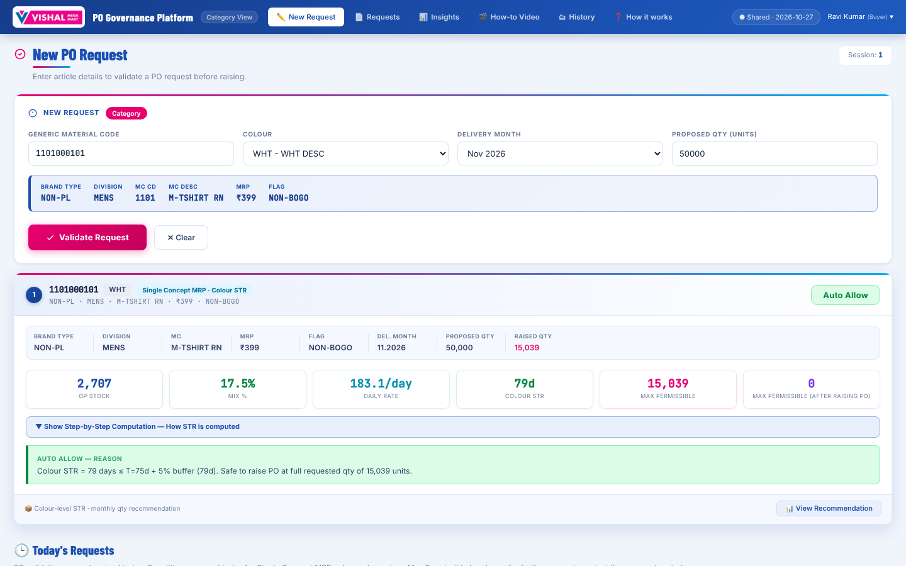

1. Tab **✏️ New Request**.
2. **Generic Material Code** — type the GM (e.g. `1101000101`). After 3 characters a strip shows the article's Brand
   Type, Division, MC CD, MC Desc, MRP and Flag — check it is the right article.
3. **Colour** — pick from the list (colours with stock, POs or sales for this GM). Not listed? Choose **+ Enter colour
   manually...** and type the colour code.
4. **Delivery Month** — the month the goods arrive.
5. **Proposed Qty (units)** — the quantity you want to order.
6. Click **Validate Request** (or press Enter in the quantity box).

If you see "⚠ Upload required files first: …", the planner has not loaded today's data yet — try again later or tell
the planning team.

### 3.3 Confirm the final quantity (Single Concept articles)

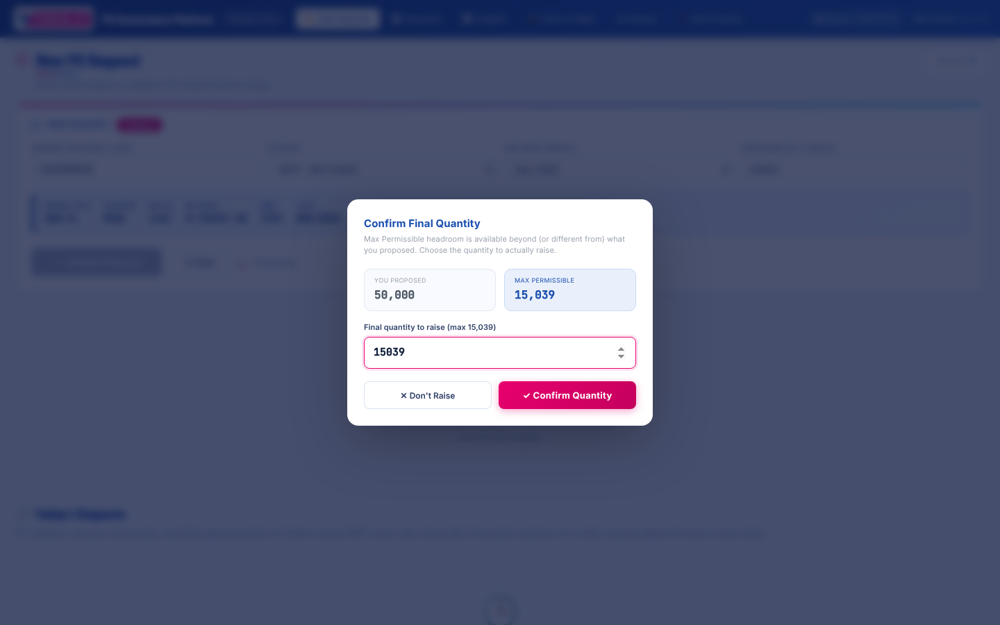

For a Single Concept article with room left ("Max Permissible" above 0) the portal asks **how much you will actually
raise**:

- **You proposed** — your quantity; **Max Permissible** — the most that keeps stock within the norm.
- **Final quantity to raise** is pre-filled with Max Permissible; change it if you want less.
- Click **✓ Confirm Quantity** — or **✕ Don't Raise** if you decide not to order (counted as 0).

The confirmed quantity is what counts for the day (shown as **Raised Qty** on the card).

### 3.4 Read the result

Each request gets a card (newest on top) with a request number, the engine used, the **decision** (coloured pill on
the right) and the **reason**:

| Engine chip | When | What it looks at |
|---|---|---|
| **Single Concept MRP · Colour STR** | GM is in the Universe Master | Stock + open POs + your PO against the sales plan → days of cover ("Colour STR") |
| **Multi Concept MRP · Peer BSR** | GM is in the Best Seller Report | How fast this style sells compared with similar styles (quartile Q1–Q4) |
| **New Product** | GM is in neither | New article — allowed |

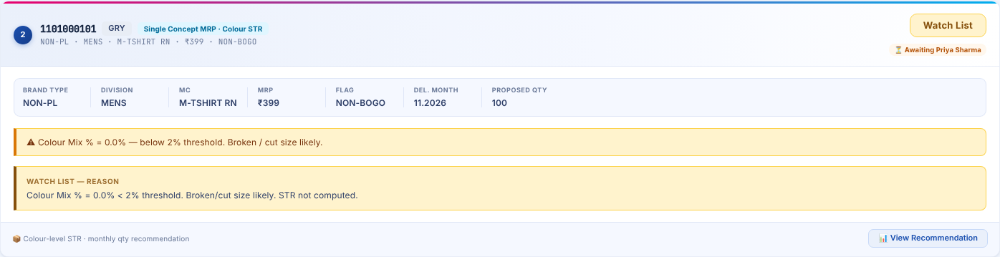

The **decisions**:

| Decision | Meaning | What you do |
|---|---|---|
| **Auto Allow** / **Allow** | Within the norms | Raise the PO (at the confirmed quantity for Single Concept) |
| **Watch List** | Borderline — the category head must approve (e.g. colour share below 2 %, or a Q3/Q4 seller near the average) | Wait; the card shows "⏳ Awaiting <name>". The decision appears in **Requests** |
| **Hold — Don't Raise** | Stock + open POs already cover more than the norm; the reason shows the Max Permissible (often 0) | Do not raise, or raise at most the quantity shown |
| **Block** | Confirmed slow seller (bottom quartile far below average, or sell-through below 1 %/day after 4+ weeks) | Do not raise |
| **Cannot Validate** | The article could not be identified (not in the masters) or the month is invalid | Check the GM and month; tell the planner if the article is missing |

Single Concept cards show the key figures — **Op Stock, Mix %, Daily Rate, Colour STR, Max Permissible** — and
**▼ Show Step-by-Step Computation** explains every step (stock, colour mix, month-by-month stock roll, STR, Max
Permissible). Multi Concept cards show the peer pool, the sell-through vs. the peer average, the quartile and the border
zone check.

### 3.5 View Recommendation

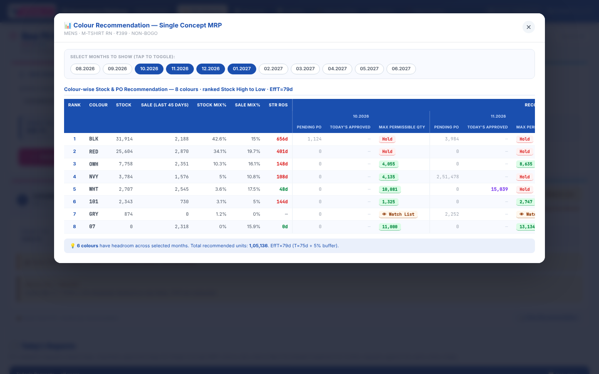

Click **📊 View Recommendation** on a card to see the alternatives:

- **Single Concept** — every colour of the same Brand / MC / MRP / Flag with stock, pending PO, today's approved
  quantity, sales of the last 45 days, STR, and the **Max Permissible quantity per month**. Tap months at the top to
  show or hide them.
- **Multi Concept** — which attribute (style, fit, material, design) and which colours / GMs sell best (Q1 → Q2), with a
  recommended quantity.

**⬇ Download Excel (all columns)** saves the table.

### 3.6 Requests — today's list

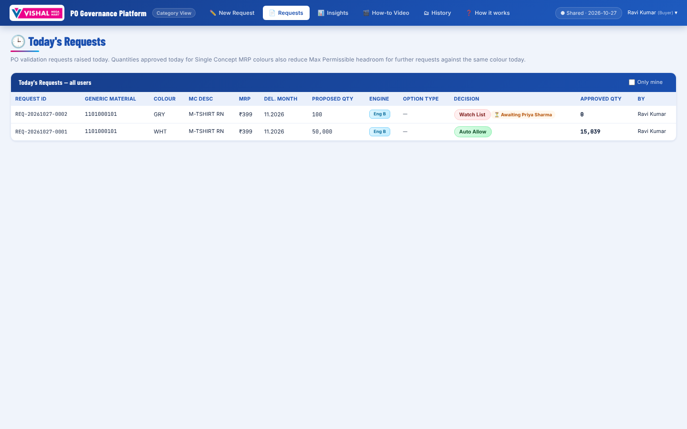

Tab **📄 Requests** shows today's requests you may see (yours and those on your MCs): request ID, article, colour,
month, proposed qty, engine, **decision with approval status**, **approved qty** and who raised it. Tick **Only mine**
to see just yours. The list updates by itself when a category head decides.

Approval status texts: "⏳ Awaiting …", "✓ Approved by … · qty", "✕ Rejected by …", "⊘ Cleared by admin – no longer
waiting".

### 3.7 Insights — category dashboard

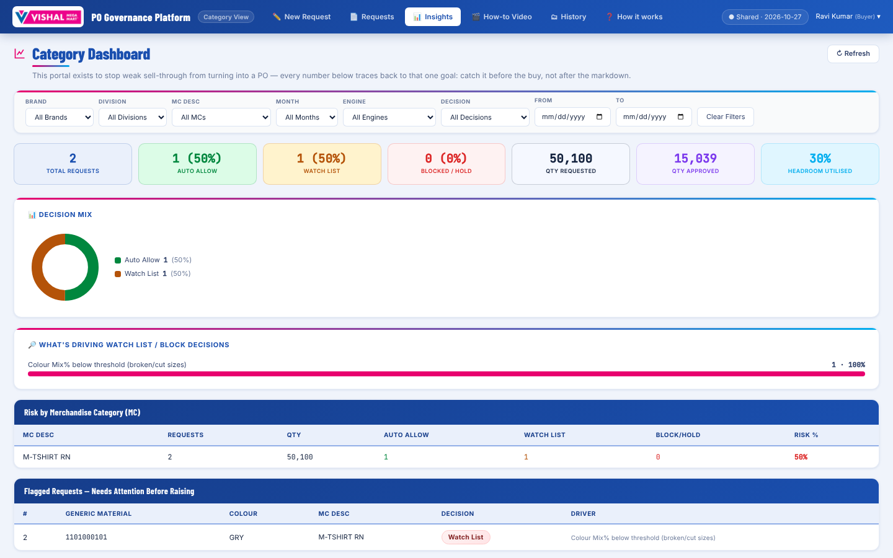

Tab **📊 Insights**: totals of requests and decisions (Auto Allow, Watch List, Blocked / Hold), quantities requested vs.
approved, the decision mix, what drives Watch List / Block decisions, risk by MC, and the flagged requests. Filter by
brand, division, MC, month, engine, decision and date range (empty dates = today).

### 3.8 History — your earlier requests

Tab **🗂 History** → **✏️ Tool 1 requests**: pick a date range (Today, Last 7 days, Last 30 days, This month, Last 90
days, All) and click **Show**. Search, filter by decision, click a request ID for the full details, and **⬇ Excel** to
download. Cleared requests are shown faded with "cleared by …".

---

## 4. Category head guide

You can do everything in the buyer guide (section 3). In addition you **approve or reject Watch List requests** on the
MCs mapped to you.

### 4.1 Approve or reject

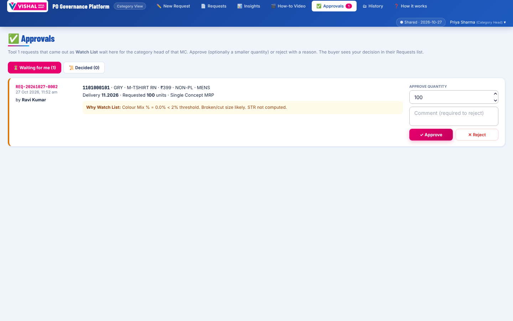

1. Tab **✅ Approvals** (the red number = requests waiting for you).
2. **⏳ Waiting for me** lists each request with the article, colour, MC, MRP, delivery month, requested units, engine
   and **Why Watch List** (the reason).
3. To approve: keep or lower **Approve quantity** (0 up to the requested quantity) and click **✓ Approve**.
4. To reject: write a **Comment** (required) and click **✕ Reject**.
5. **📜 Decided** shows what you decided earlier (last 120 days).

Rules: you cannot approve your own requests (they never appear in your list); once approved, a request cannot be
decided again. The buyer sees your decision immediately in Requests and History. An approved quantity counts against
that colour for the rest of the day.

### 4.2 What you see

Requests, Insights and History show the requests on **your** MCs (from the SCR products file). If an MC is missing,
ask the administrator to update the SCR mapping.

---

## 5. Planner guide

Planners and admins start in the **Planner view**. Use **⇄ Switch to Category view** (user menu) to raise or check a
request like a buyer.

### 5.1 Data Setup — load the data

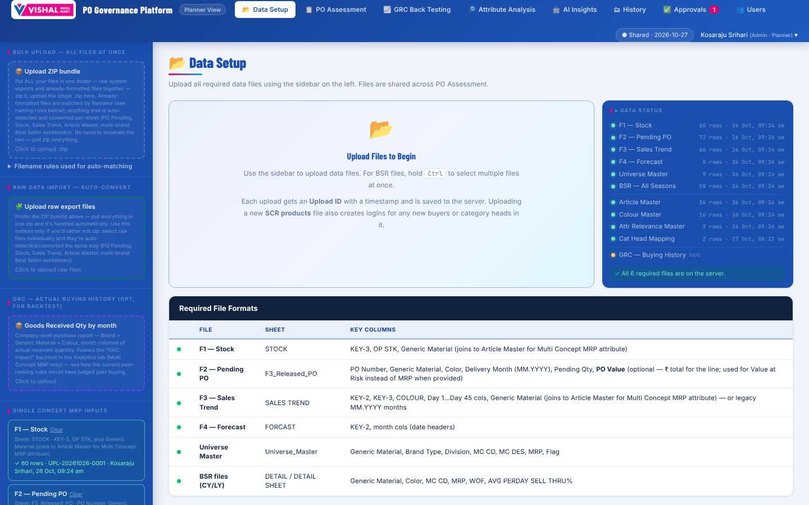

Tab **📂 Data Setup**. All files you load are shared: everyone uses them as soon as they are saved, and History keeps
every version.

**The files**

| File | Required | What it is |
|---|:-:|---|
| F1 — Stock | ✓ | Closing stock by Brand × MC × MRP × Flag × colour (`OP STK`) |
| F2 — Pending PO | ✓ | Released open POs: PO number, GM, colour, delivery month (MM.YYYY), pending qty, PO value |
| F3 — Sales Trend | ✓ | Daily sales of the last 45 days per colour (`Day 1` = oldest) |
| F4 — Forecast | ✓ | Monthly plan by Brand × MC × MRP × Flag (`MM.YYYY` columns) |
| Universe Master | ✓ | GMs of the Single Concept universe |
| BSR — All Seasons | ✓ | Weeks on floor and per-day sell-through % per GM and colour (several files allowed) |
| Article Master | optional | Article attributes (season, style, fit, material, design, vendor) |
| Attr Relevance Master | optional | Which attribute matters per Brand × MC × MRP × Flag |
| Colour Master | optional | Colour codes and descriptions |
| SCR Products / Cat Head Mapping | optional | Buyers and category heads per Brand × MC × MRP — **creates their logins** |
| GRC — Buying History | optional | Goods received per month or week — only for GRC Back Testing |

**Three ways to upload (left sidebar)**

1. **📦 Upload ZIP bundle** (recommended) — put all files in one zip. Pre-formatted files are recognised by name
   (open **Filename rules used for auto-matching**: `F1_Stock…`, `F2_Pending…`, `F3_Sales…`, `F4_Forecast…`,
   `UniverseMaster`, `ArticleMaster`, `ColourMaster`, `AttributeRelevance`, `BSR…`); raw SAP/BW exports inside the zip
   are recognised by their columns and converted. A report lists what was loaded and what is missing.
2. **🧩 Upload raw export files** — the same automatic conversion without a zip (stock, pending PO, sales trend, article
   master, BSR exports).
3. **One slot per file** — click a slot (e.g. **F1 — Stock**) and choose the file. **BSR** accepts several files
   (hold Ctrl) and adds them to what is already loaded; use its **Clear** link first to start fresh.

Accepted: `.xlsx`, `.xls`, `.xlsb`, `.csv`, up to 400 MB per upload. Each save shows "Saved · UPL-… — Everyone who
opens this page now gets the data you uploaded." A slot shows "✓ rows · Upload ID · who, when".

**Data Status** (right, and in the sidebar of other planner pages): green = on the server, red = required and
missing, amber = optional and missing. "✓ All 6 required files are on the server." means Tool 1, Tool 2 and SAP checks
can run.

**Clear** on a slot removes the current file for everyone (History keeps every version).

### 5.2 Parameters and seasons

In the Data Setup sidebar:

**⚙ Parameters** — each value saves as soon as you change it ("✓ Parameters saved to server (v…)"):

| Parameter | Default | Used for |
|---|---|---|
| STR Threshold T (days) — Tool 1 | 75 | maximum days of cover for a new PO |
| STR Threshold T (days) — Tool 2 | 100 | maximum days of cover when reviewing raised POs |
| Window D (days) | 75 | length of the cover window after delivery |
| Mix % Min | 2 | colour share below this → Watch List (broken / cut size) |
| Ref Period N (months) | 2 | latest sales months used for the colour mix when the sales file has month columns instead of daily ones |
| WOF Gate (weeks) | 4 | minimum weeks on floor before a style is judged |
| Peer Min (styles) | 5 | minimum comparable styles for a peer ranking |
| STR Buffer % (Single Concept) | 5 | tolerance on T (75 d + 5 % = 79 d) |
| Border Zone % (Multi Concept) | 10 | tolerance around the peer average |
| Mix Window (days) | 45 | days of F3 used for the colour mix |
| Prev-month PO cut-off (day) | 5 | until this day of the month, POs still pending from last month are counted in the current month |

**Season Selection** — click season pills to set the **Current Season(s)** and **Fallback Season(s)** (seasons come
from the Article Master). By default the latest season is current and the previous one is the fallback.

### 5.3 PO Assessment — review all open POs (Tool 2)

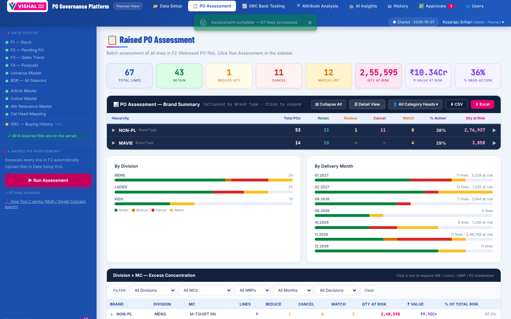

1. Tab **📋 PO Assessment** → **▶ Run Assessment** (sidebar). Every line of F2 is assessed; each run is saved with a Run ID.
2. **KPIs**: Total Lines, Retain, Reduce Qty, Cancel, Watch List, Qty at Risk, ₹ Value at Risk, % Need Action. Click a
   decision KPI to open the matching lines.
3. **Brand Summary** — expand Brand Type → Division → MC → MRP → PO lines.
4. **☰ Detail View** — "Action Required — Detailed List", sorted by quantity at risk; filter by Brand, Division, MC,
   MRP, month and action (🚫 Cancel, ⬇ Reduce, 👁 Watch, ✅ Retain). Open a line for **Why this action**, the STR steps and
   **PO-wise Allocation** (largest PO cut first).
5. **Exports** — choose category heads (or **One file per Category Head (ZIP)**) and click **⬇ Excel** or **⬇ CSV**.
6. Charts by division and delivery month; tables of excess concentration, engine split and vendors.

Tool 2 decisions: **Retain** (keep), **Reduce Qty** (cut to Max Permissible), **Cancel** (stock without the PO already
exceeds the norm), **Watch List**, **Cannot Validate**.

### 5.4 GRC Back Testing

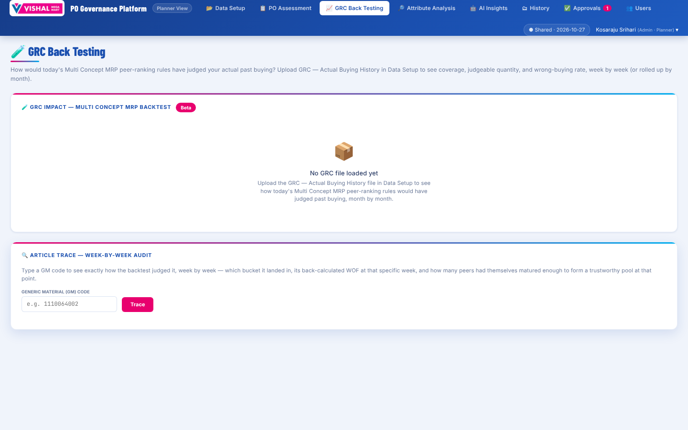

Needs the GRC buying-history file (Data Setup). Shows how today's Multi Concept rules would have judged past buying:
choose **Assess as of**, **View by** week or month and the comparison period; filter by brand, division, category head
or period; **⬇ Export Row Detail**. **🔍 Article Trace** shows one GM week by week (bucket, quantity, reasoning).
Q1 = best, Q4 + Absolute Block = "wrong buy".

### 5.5 Attribute Analysis

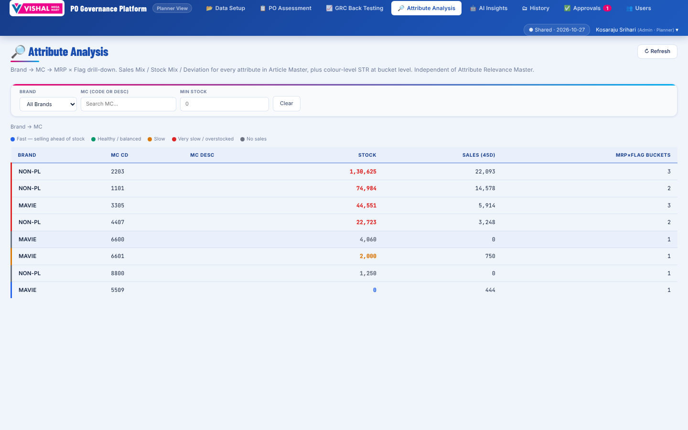

Drill down Brand → MC → MRP × Flag → attribute / colour: stock, sales (45 days), sales mix %, stock mix %, deviation and
STR (No Sales, Fast < 30, Healthy < 75, Slow < 120, Very Slow). Filter by brand, MC and minimum stock.

### 5.6 AI Insights and Planner Dashboard

Tab **🤖 AI Insights** (after a PO Assessment run): choose a **Focus** and click **✨ Generate Insights** for
cross-cutting findings and the first actions. **📊 Planner Dashboard** shows the decision mix, the drivers of Reduce /
Cancel / Watch, risk by MC and recommendations, with filters. (AI features appear only if enabled on the server.)

### 5.7 History — runs and uploads

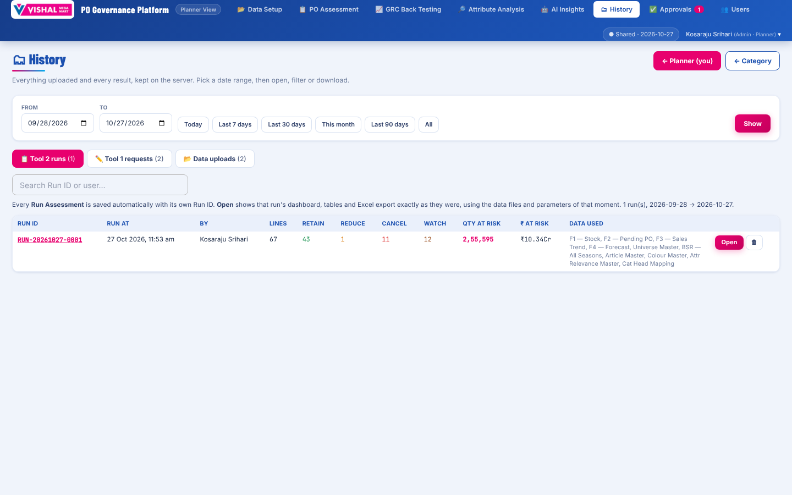

Tab **🗂 History**, pick a date range:

- **📋 Tool 2 runs** — every assessment with its counts; **Open** shows it exactly as it was (data and parameters of
  that moment), 🗑 deletes a saved run.
- **✏️ Tool 1 requests** — all requests, **⬇ Excel**.
- **📂 Data uploads** — every upload (ZIP bundle, Raw import, File upload, Made current again, Cleared) with its files.
  **View files →** opens one upload: **⬇ All files (one Excel)**, **⬇ Excel** per file, **Make current** for one file
  or **Make this upload current** for all — to go back to earlier data for everyone.

### 5.8 Approvals and today's requests

- Planners can approve or reject **any** Watch List request (Approvals tab, section 4.1), except their own.
- **Requests → Clear All** (planners and admins) clears **all** of today's requests for every user: it resets the day's
  Max Permissible ledger and cancels Watch List requests still waiting. The requests stay in History, marked as
  cleared. Use it only when the day has to start again (e.g. after wrong data).

---

## 6. Administrator guide

Admins can do everything planners can (section 5). Admin pages are in the **👥 Users** tab and the user menu.

### 6.1 Users & Security

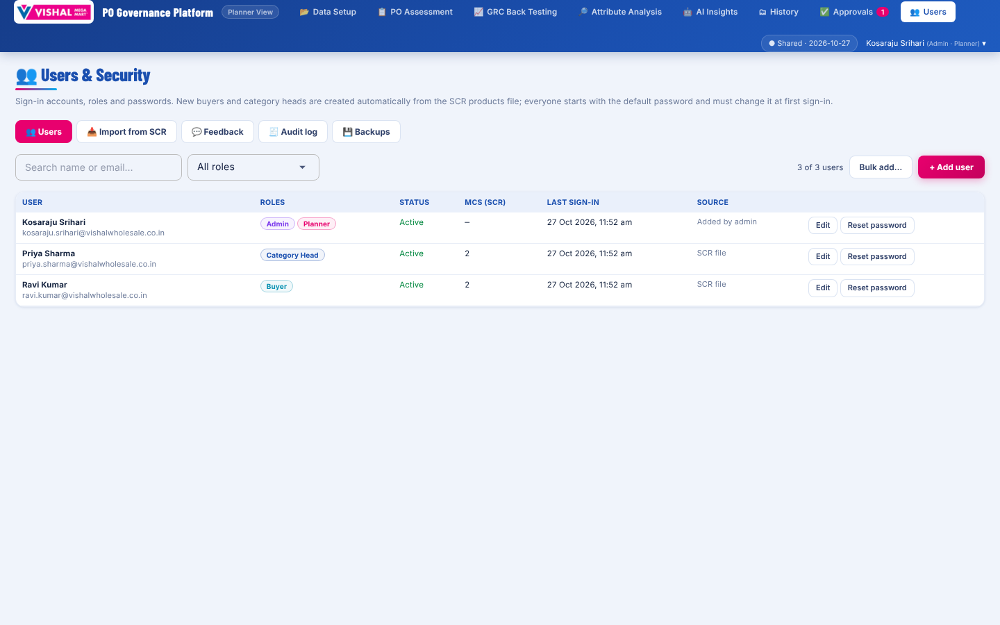

Tab **👥 Users** → **👥 Users**:

People sign in with their **Employee ID** and **HRMS password**, and **only people you register here can sign in**.
The portal never talks to HRMS itself: the server fetches the employee from HRMS when you register them, and at sign-in
asks HRMS for the password only for registered, active employees.

- **+ Add user** → **Employee ID** → **🔍 Fetch from HRMS**: the card shows name, email, department, designation,
  location, mobile, reporting manager, grade and **HRMS status**. Tick the roles (Buyer, Category Head, Planner, Admin)
  and click **Add user**. Refused with a red line: unknown ID, **Resigned** / **Inactive** in HRMS, or **Already
  registered**. If HRMS has no email for the employee, type the company email. No password is set or shown.
- **Bulk add…** — one employee per line: `Employee ID, role` (roles combined with `+`, e.g. `102345, planner+buyer`);
  paste from Excel works. Every ID is fetched from HRMS; "Added N · M skipped" lists unknown, resigned and
  already-registered IDs.
- **Edit** — name, roles, **Active (can sign in)**; **↻ Refresh from HRMS** re-reads the details. A login without an
  Employee ID (status **⚠ Employee ID needed**, e.g. created from the SCR file) gets **Employee ID → Fetch from HRMS →
  Link to this employee**; registering the same employee with **+ Add user** links it too and keeps its roles.
  **Delete user** (prefer unticking Active: the next SCR upload would re-create a deleted login).
- **Unlock** — for an account locked after 5 wrong passwords (HRMS locks are unlocked in MyVishal).
- **Reset password** — only for the built-in admin account (employees' passwords live in HRMS).
- The user column shows **ID 102345 · designation · department**. Status: Active, ⚠ Employee ID needed, 🔒 Locked,
  Inactive; filter **Employee ID needed** in the role list. **MCs (SCR)** = mapped MCs; **Source** = SCR file / Added by
  admin / Bulk add / Built-in.
- **Built-in admin** (`PoGovSettings:AdminEmail`): signs in with its email and a local password while
  `AllowAdminLocalLogin` is on — for the first set-up and when HRMS is down. Set `AdminEmpCode` so it can sign in with
  HRMS, then switch `AllowAdminLocalLogin` off.

Safeguards: you cannot remove your own admin role or deactivate yourself, and at least one active admin must remain.

**📥 Import from SCR** — after the SCR products file is uploaded in Data Setup: for each email column choose **Treat
as** Buyer, Category Head or Skip (e.g. Division Head), check "N people, M new", then **Save & create logins**. Existing
users are never removed or demoted.

### 6.2 Audit log

User menu → **📜 Audit log** (or Users → 🧾 Audit log): date range and search, then **Show**. Every sign-in (failed ones
in red), lock-out, password change, user change, upload, clear, make-current, Tool 1 request, approval, parameter
change, Tool 2 run, clear-all, SCR sync and backup.

### 6.3 Backups

User menu → **💾 Backups**: the server saves a copy of all shared data **every night after 02:00** and keeps it **30
days** in the folder shown. **💾 Back up now** makes one immediately. Copy the folder to another drive regularly.

### 6.4 All feedback

User menu → **📥 All feedback**: filter New / In progress / Closed, search, see the average usefulness rating. For each
item set the status and write a **Reply / note** (the user sees it), then **Save**.

### 6.5 SAP Interface

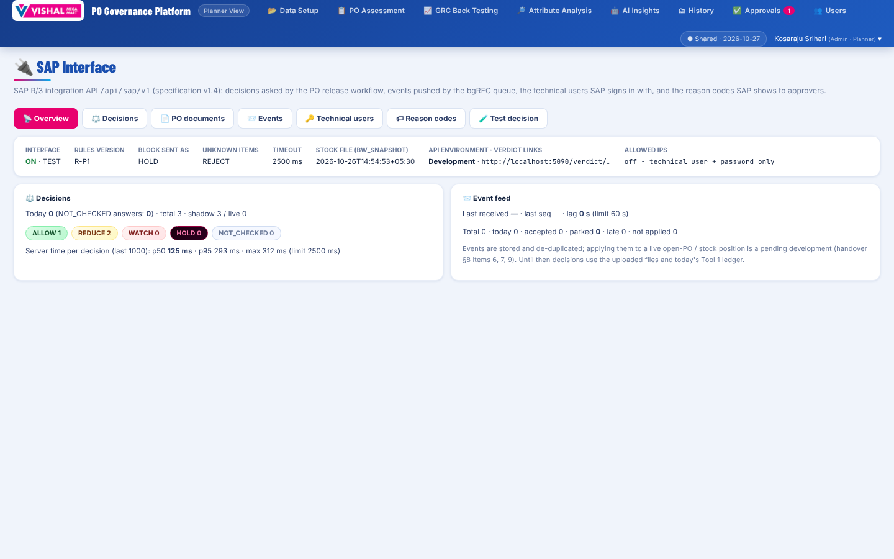

User menu → **🔌 SAP Interface** — the automatic PO check SAP calls when a PO is released.

| Tab | What you do there |
|---|---|
| **📡 Overview** | Is the interface ON; rules version; API environment and **verdict links** address; allowed IPs; today's decisions and NOT_CHECKED answers; verdict counts; response times; event feed lag and parked events |
| **⚖️ Decisions** | Every SAP check: filter by date, PO / request ID, verdict, mode, answer; open one to see its items, reasons, the request and response JSON, the **final document (MRN)** and **🔗 Open verdict page ↗** |
| **📄 PO documents** | Checked POs **with** a final SAP document (PO generated), **without**, or all; filters; **⬇ Excel**; a row opens the decision |
| **📨 Events** | PO / goods-receipt / return events SAP sent: type, status (parked = rejected with reason), order, lag |
| **🔑 Technical users** | The SAP system logins (one per SAP system, e.g. `sap_ecq`, `sap_ecp`): **+ Add technical user** (password ≥ 24 characters, or leave empty to generate one — **shown once**), Reset password, Disable / Enable, Unlock |
| **🏷 Reason codes** | Exception reasons SAP shows to approvers (code ≤ 4, text ≤ 60 characters): add, activate, deactivate; read-only list of verdict reason codes |
| **🧪 Test decision** | **Load sample**, edit, **Run test decision** — runs through the real rules, logged as a test (`TEST-` request ID) |

If the Overview says **"no links: no active API_BASE_URL row POGOV_PORTAL for environment …"**, SAP answers carry no
verdict link: the server's environment setting or the portal address row needs fixing (IT).

---

## 7. Verdict page (link from SAP)

When SAP checks a PO, its answer contains a **link** to the verdict. Clicking it opens the verdict page — **no
sign-in needed**.

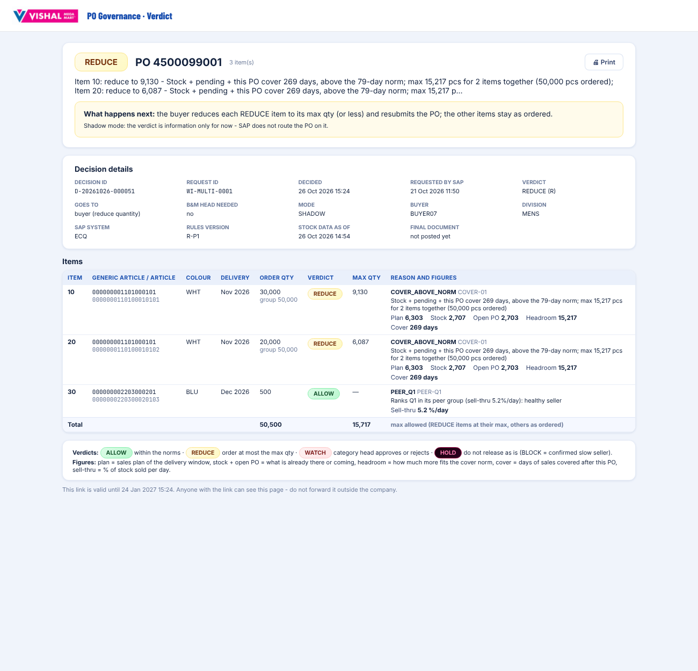

- **The verdict** (ALLOW, REDUCE, WATCH, HOLD) and **What happens next** — e.g. REDUCE: "the buyer reduces each REDUCE
  item to its max qty (or less) and resubmits the PO".
- **Decision details** — decision and request ID, when decided, where the PO goes, mode (SHADOW = information only for
  now), buyer, division, rules version, date of the stock data, final document.
- **Items** — per PO item: article, colour, delivery, order qty, verdict, **max qty**, the reason and the figures
  behind it (plan, stock, open PO, headroom, cover days or sell-through).
- **🖨 Print** — print, or choose "Save as PDF" in the print dialog.

The link works for 90 days. **Anyone with the link can open the page — do not forward it outside the company.**

---

## 8. Reference: decisions, terms, messages

### 8.1 Decisions

**New Request (Tool 1)**

| Decision | Colour | Meaning |
|---|---|---|
| Auto Allow | green | Single Concept within the cover norm, or a new article |
| Allow | green | Multi Concept: sells well vs. peers (Q1 / Q2, or Q3 near the average), or too little history to judge |
| Watch List | brown | Category head must approve: colour share below the minimum, or a weak seller near the border |
| Hold — Don't Raise | red | Cover already above the norm — no or limited headroom (Max Permissible) |
| Block | red | Confirmed slow seller — do not raise |
| Cannot Validate | grey | Article or month not recognised |

**PO Assessment (Tool 2):** Retain · Reduce Qty · Cancel · Watch List · Cannot Validate.

**SAP verdicts:** ALLOW · REDUCE (order at most the max qty) · WATCH (category head) · HOLD (do not release as is; a
slow seller is sent as HOLD with reason BLOCK).

### 8.2 Terms

| Term | Meaning |
|---|---|
| **GM** | Generic Material — the article code (all sizes of one style) |
| **MC / MRP / Flag** | Merchandise category, maximum retail price, BOGO / NON-BOGO — together with Brand Type they define the bucket the rules work on |
| **Single Concept MRP** | GMs in the Universe Master; judged by stock cover per colour |
| **Multi Concept MRP** | GMs in the Best Seller Report; judged against similar styles |
| **True Repeat / BOBs / New Option** | Same GM + colour sold before / a new colour of a style that sold / never sold |
| **STR (Colour STR)** | Days of sales covered by stock + open POs + this PO after delivery |
| **T, D** | STR threshold (days) and cover window (days) — see Parameters |
| **Max Permissible** | The most units that can still be ordered without exceeding the norm |
| **Colour Mix %** | The colour's share of the bucket's recent sales; below 2 % → Watch List |
| **PDSTR** | Average per-day sell-through % (from BSR) |
| **WOF** | Weeks on floor |
| **Q1–Q4** | Quartile of a style's sell-through among its peers (Q1 top, Q4 slowest) |
| **Border zone** | Tolerance around the peer average (default 10 %) |
| **Watch List** | Request that needs the category head's approval |
| **SCR products file** | Mapping of Brand × MC × MRP to buyers and category heads; creates logins |
| **Upload ID / Request ID / Run ID** | `UPL-…`, `REQ-…`, `RUN-…` — reference numbers in History |
| **MRN** | Final SAP document number posted against a checked PO |

### 8.3 Common messages

| Message | What to do |
|---|---|
| "The security code didn't match…" | Type the characters of the new picture (↻ for another one) |
| "You were signed out because your account was signed in on another device." | Only one device at a time — sign in again here to continue (that signs out the other one) |
| "Your access was changed by the administrator. Please sign in again." | Sign in again to get your new roles |
| "You were signed out after a period of inactivity." | 30 minutes without activity — sign in again |
| "Employee ID or password is incorrect" | Check the Employee ID and HRMS password; if both are right, you are not registered — ask the administrator. After 5 tries you are locked for 15 minutes |
| "Sign in with your Employee ID and HRMS password." | You typed an email: use your Employee ID |
| "Your HRMS account is locked…" | Unlock it in MyVishal (My Page → Unlock User) or wait about 30 minutes |
| "Your HRMS record is not active." | HRMS shows you as resigned / inactive — contact the administrator |
| "Sign-in is temporarily unavailable (HRMS did not answer)…" | Try again in a few minutes; if it stays, tell IT |
| "Too many wrong attempts…" | Wait 15 minutes or ask the admin to **Unlock** you |
| "⚠ Upload required files first: …" | The planner must load the missing files in Data Setup |
| "This Brand / MC / MRP is not mapped to you in the SCR products file." | Ask the admin to update the SCR mapping |
| "Watch List — sent to … for approval" | Nothing to do; wait for the decision in Requests |
| "⚠ Another request for this colour was approved first — your approved qty was capped to N" | Someone used the headroom first today; raise at most N |
| "You cannot approve or reject your own request" | Another category head or a planner must decide |
| "New data on the server." | Click **Load now** |
| "Server unreachable" | Wait a minute; if it stays, tell IT |
| "Cannot reach the server" (sign-in page) | The API server is down or the address is wrong — tell IT |
| Verdict page "This verdict link is not valid." / "…expired" | The link is wrong or older than 90 days — ask for the PO to be checked again |

### 8.4 Who to contact

| Topic | Contact |
|---|---|
| Access (registration), roles, MCs | Tool administrator |
| HRMS password, HRMS lock | MyVishal / HR |
| Missing or wrong data, parameters | Planning team |
| A decision looks wrong | 💬 Feedback (type "Data looks wrong", with GM and colour) |
| SAP check / verdict link | SAP team / tool administrator |
